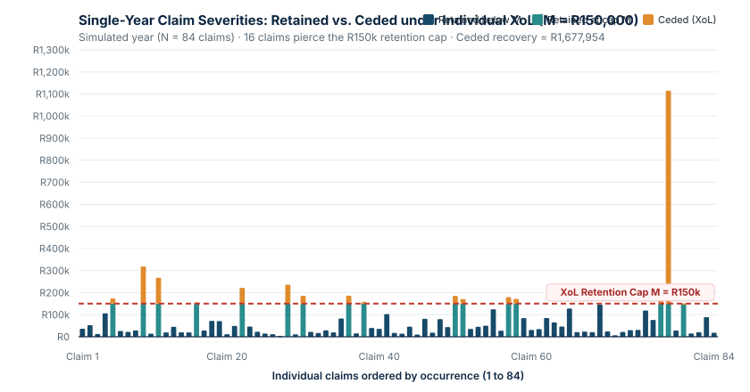
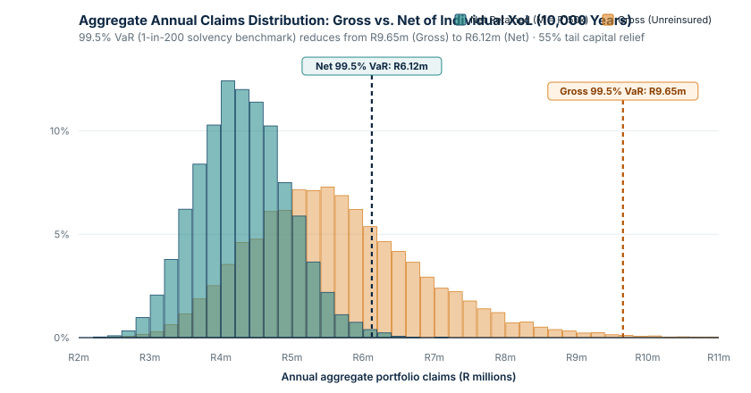

## Introduction

In general insurance and cell-captive management, aggregate claims volatility is
rarely driven by routine attritional losses alone. Instead, a small number of
high-severity claims from a right-skewed loss distribution can distort annual
profitability, erode cell capital, and inflate solvency capital requirements
under frameworks such as Solvency Assessment and Management (SAM).

An **Individual Excess of Loss (XoL)** reinsurance treaty addresses this
directly by capping each individual claim at a chosen retention threshold $M$
and ceding the excess layer above $M$ to the reinsurer.

This article combines closed-form loss-distribution theory with **Monte Carlo
stochastic simulation in R** to demonstrate:

- how individual heavy-tailed claims behave before and after an Excess of Loss
  retention cap $M$;
- how analytical limited expected value (LEV) formulae reconcile with simulated
  retained and ceded claim recoveries;
- how capping individual claims compresses the upper tail of the annual
  aggregate portfolio loss distribution; and
- how changing the retention $M$ trades off expected ceded premium against
  1-in-200 tail capital relief ($\text{VaR}_{0.995}$).

---

## Mathematical Framework

### Collective Risk Model (Gross of Reinsurance)

Let $N$ denote the number of claims occurring in a one-year policy period and
$X_1, X_2, \dots, X_N$ denote the individual ground-up claim severities. Under
the standard collective risk model:

1. $N \sim \text{Poisson}(\lambda)$, with $\operatorname{E}[N] = \operatorname{Var}(N) = \lambda$;
2. $X_1, X_2, \dots$ are independent and identically distributed positive random
   variables, independent of $N$; and
3. the gross annual aggregate portfolio loss is

$$
S_{\text{gross}} = \sum_{i=1}^{N} X_i,
\qquad \text{with } S_{\text{gross}} = 0 \text{ when } N = 0.
$$

When individual claim severities follow a two-parameter Lognormal distribution,
$\ln X_i \sim \mathcal{N}(\mu, \sigma^2)$, the untamed k-th raw moment is
$\operatorname{E}[X^k] = \exp\!\left(k\mu + \tfrac{1}{2}k^2\sigma^2\right)$. By
Wald's identities for a compound Poisson process,

$$
\operatorname{E}[S_{\text{gross}}] = \lambda \operatorname{E}[X],
\qquad
\operatorname{Var}(S_{\text{gross}}) = \lambda \operatorname{E}[X^2].
$$

### Individual Excess of Loss (XoL) Treaty at Retention $M$

Under an unlimited per-risk Excess of Loss treaty with attachment (retention)
point $M > 0$, each ground-up claim $X_i$ is partitioned into two orthogonal
layers:

$$
Y_i = \min(X_i, M) \quad \text{(Retained by the insurer / cell)},
$$

$$
Z_i = \max(X_i - M, 0) \quad \text{(Ceded to the XoL reinsurer)},
$$

such that $X_i = Y_i + Z_i$ holds identically for every claim. The net retained
and ceded annual aggregate losses are therefore

$$
S_{\text{net}}(M) = \sum_{i=1}^{N} \min(X_i, M),
\qquad
S_{\text{ceded}}(M) = \sum_{i=1}^{N} \max(X_i - M, 0).
$$

For $X \sim \text{Lognormal}(\mu, \sigma^2)$, the limited expected value
$\operatorname{E}[\min(X, M)]$ admits the exact closed-form expression:

$$
\operatorname{E}[Y] = \operatorname{E}[\min(X, M)]
= \exp\!\left(\mu + \frac{\sigma^2}{2}\right)
  \Phi\!\left(\frac{\ln M - \mu - \sigma^2}{\sigma}\right)
  + M\left[1 - \Phi\!\left(\frac{\ln M - \mu}{\sigma}\right)\right],
$$

and the second retained raw moment is

$$
\operatorname{E}[Y^2] = \operatorname{E}[\min(X, M)^2]
= \exp\!\left(2\mu + 2\sigma^2\right)
  \Phi\!\left(\frac{\ln M - \mu - 2\sigma^2}{\sigma}\right)
  + M^2\left[1 - \Phi\!\left(\frac{\ln M - \mu}{\sigma}\right)\right],
$$

where $\Phi(\cdot)$ is the standard normal cumulative distribution function.
While these expressions give exact means and variances for $S_{\text{net}}(M)$,
evaluating high quantiles such as the **99.5% Value-at-Risk ($\text{VaR}_{0.995}$)**
and **99% Tail Value-at-Risk ($\text{TVaR}_{0.99}$)** requires numerical
approximation or Monte Carlo simulation.

---

## Interactive Claims & Reinsurance Simulation Lab

Use the controls below to test how an Individual Excess of Loss retention cap
$M$ reshapes both **single-year individual claim recoveries** and the
**multi-year aggregate portfolio loss distribution** across 3,000 simulated
years.

```{=html}
<section class="reins-console" id="reinsurance-sim-console" aria-label="Interactive Claims and Excess of Loss Reinsurance Simulator">
  <div class="reins-toolbar">
    <label for="sim-retention">Individual XoL retention cap (M)
      <select id="sim-retention">
        <option value="100000">R100,000 per claim</option>
        <option value="150000" selected>R150,000 per claim (Baseline)</option>
        <option value="250000">R250,000 per claim</option>
        <option value="500000">R500,000 per claim</option>
        <option value="inf">Unlimited (Gross — No Reinsurance)</option>
      </select>
    </label>
    <label for="sim-lambda">Expected claim frequency (λ)
      <select id="sim-lambda">
        <option value="50">50 claims / year</option>
        <option value="80" selected>80 claims / year (Baseline)</option>
        <option value="120">120 claims / year</option>
      </select>
    </label>
    <label for="sim-sigma">Severity tail skewness (σ)
      <select id="sim-sigma">
        <option value="0.95">Moderate tail (σ = 0.95)</option>
        <option value="1.15" selected>Baseline heavy tail (σ = 1.15)</option>
        <option value="1.30">Severe heavy tail (σ = 1.30)</option>
      </select>
    </label>
    <button type="button" class="btn btn-outline-primary" id="sim-reseed-btn"> Draw new sample seed</button>
  </div>
  <p class="reins-status" id="sim-status" role="status" aria-live="polite"></p>
  <div class="reins-kpi-grid" id="sim-kpi-grid" aria-label="Simulation summary metrics"></div>
  <div class="reins-chart-card" id="sim-chart-claims"></div>
  <div class="reins-chart-card" id="sim-chart-agg"></div>
  <noscript>JavaScript is required for the interactive controls. The full static R implementation, tables, and charts appear below.</noscript>
</section>
```

---

## Reproducible Implementation in R

### 1. Portfolio Parameters and Analytical Limited Expected Values

We parameterise a synthetic short-term portfolio with $\lambda = 80$ expected
claims per annum and Lognormal individual severities ($\mu = 10.5$,
$\sigma = 1.15$), giving an untamed mean severity of $\text{R}70{,}351$ and a
gross expected annual portfolio loss of $\text{R}5.63\text{ million}$.

::: {.cell}

```{.r .cell-code}
set.seed(2026)

# Portfolio parameters
lambda <- 80
mu_log <- 10.5
sd_log <- 1.15
retention_base <- 150000
n_sims <- 10000

format_rand <- function(x) {
  paste0("R", format(round(x, 0), big.mark = ",", scientific = FALSE))
}

# Exact closed-form Limited Expected Value E[min(X, M)^k] for Lognormal(mu, sigma)
lognormal_lev <- function(M, mu, sigma, k = 1) {
  raw_moment <- exp(k * mu + 0.5 * k^2 * sigma^2)
  if (is.infinite(M)) return(raw_moment)

  d_shift <- (log(M) - mu - k * sigma^2) / sigma
  d_base  <- (log(M) - mu) / sigma
  exceed  <- 1 - pnorm(d_base)

  raw_moment * pnorm(d_shift) + (M^k) * exceed
}

retentions <- c(100000, 150000, 250000, 500000, Inf)

analytical_table <- do.call(rbind, lapply(retentions, function(M) {
  ex  <- lognormal_lev(Inf, mu_log, sd_log, k = 1)
  ey  <- lognormal_lev(M,   mu_log, sd_log, k = 1)
  ey2 <- lognormal_lev(M,   mu_log, sd_log, k = 2)
  ez  <- ex - ey
  p_pierce <- if (is.infinite(M)) 0 else 1 - pnorm((log(M) - mu_log) / sd_log)

  data.frame(
    Treaty_Structure   = if (is.infinite(M)) "Gross (Unreinsured)" else paste0("XoL M = ", format_rand(M)),
    Pierce_Prob        = sprintf("%.2f%%", 100 * p_pierce),
    Mean_Retained_Sev  = format_rand(ey),
    Mean_Ceded_Sev     = format_rand(ez),
    Expected_Net_Agg   = format_rand(lambda * ey),
    Expected_Ceded_Agg = format_rand(lambda * ez),
    Analytical_SD_Net  = format_rand(sqrt(lambda * ey2))
  )
}))

knitr::kable(
  analytical_table,
  caption = "Analytical collective risk moments across Individual XoL retention levels"
)
```

::: {.cell-output-display}

Table: Analytical collective risk moments across Individual XoL retention levels

|Treaty_Structure    |Pierce_Prob |Mean_Retained_Sev |Mean_Ceded_Sev |Expected_Net_Agg |Expected_Ceded_Agg |Analytical_SD_Net |
|:-------------------|:-----------|:-----------------|:--------------|:----------------|:------------------|:-----------------|
|XoL M = R100,000    |18.92%      |R46,632           |R23,719        |R3,730,532       |R1,897,535         |R516,866          |
|XoL M = R150,000    |10.87%      |R53,820           |R16,530        |R4,305,632       |R1,322,435         |R638,966          |
|XoL M = R250,000    |4.67%       |R61,002           |R9,349         |R4,880,155       |R747,912           |R793,759          |
|XoL M = R500,000    |1.13%       |R66,911           |R3,440         |R5,352,860       |R275,207           |R978,346          |
|Gross (Unreinsured) |0.00%       |R70,351           |R0             |R5,628,067       |R0                 |R1,218,966        |

:::
:::

At the baseline retention of $M = \text{R}150{,}000$, approximately $10.87\%$ of
individual claims breach the treaty attachment point, ceding $\text{R}1.32\text{m}$
of expected annual claims to the reinsurer while cutting the standard deviation
of annual retained aggregate claims by nearly half (from $\text{R}1.22\text{m}$
to $\text{R}0.64\text{m}$).

---

### 2. Visualising Single-Year Claim Capping ($Y_i$ vs. $Z_i$)

Before aggregating across thousands of simulated years, it is instructive to
inspect a single simulated policy year claim by claim. Every claim below
$M = \text{R}150{,}000$ is retained in full; every claim above $M$ is truncated
at the dashed retention threshold, with the excess layer transferred to the XoL
reinsurer.

::: {.cell}

```{.r .cell-code}
# Simulate a single representative policy year
n_claims_year <- rpois(1, lambda = lambda)
year_claims   <- rlnorm(n_claims_year, meanlog = mu_log, sdlog = sd_log)

retained_layer <- pmin(year_claims, retention_base)
ceded_layer    <- pmax(year_claims - retention_base, 0)

# Stacked bar plot of Retained vs. Ceded portions for each claim
barplot(
  rbind(retained_layer, ceded_layer) / 1e3,
  beside = FALSE,
  border = NA,
  col = c("#174a69", "#e08b2c"),
  xlab = "Individual claims ordered by occurrence",
  ylab = "Claim severity (R thousands)",
  main = "Single-Year Claim Severities: Retained vs. Ceded under XoL (M = R150,000)"
)
abline(h = retention_base / 1e3, col = "#c0392b", lwd = 2, lty = 2)
```

::: {.cell-output-display}
{fig-alt="Bar chart of 84 simulated individual claims in a single policy year, showing retained claim amounts up to R150,000 in navy/teal and ceded excess recoveries above R150,000 in amber." width=100%}
:::
:::

---

### 3. Monte Carlo Simulation of Aggregate Loss & Tail Capital ($\text{VaR}_{0.995}$)

We now simulate $10{,}000$ independent portfolio years in R to evaluate the full
aggregate distribution and quantify tail risk under the **99.5% Value-at-Risk
($\text{VaR}_{0.995}$)**—the 1-in-200 solvency benchmark used in SAM standard
formula calibration—and **99% Tail Value-at-Risk ($\text{TVaR}_{0.99}$)**.

::: {.cell}

```{.r .cell-code}
simulate_collective_xol <- function(n_sims, lambda, mu_log, sd_log, retentions) {
  claim_counts <- rpois(n_sims, lambda = lambda)
  results <- matrix(0, nrow = n_sims, ncol = length(retentions))
  colnames(results) <- as.character(retentions)

  for (sim in seq_len(n_sims)) {
    n <- claim_counts[sim]
    if (n > 0L) {
      x <- rlnorm(n, meanlog = mu_log, sdlog = sd_log)
      for (j in seq_along(retentions)) {
        M <- retentions[j]
        results[sim, j] <- if (is.infinite(M)) sum(x) else sum(pmin(x, M))
      }
    }
  }
  results
}

sim_matrix <- simulate_collective_xol(
  n_sims = n_sims,
  lambda = lambda,
  mu_log = mu_log,
  sd_log = sd_log,
  retentions = retentions
)

gross_vec <- sim_matrix[, "Inf"]

sim_summary <- do.call(rbind, lapply(seq_along(retentions), function(j) {
  M   <- retentions[j]
  net <- sim_matrix[, j]
  ced <- gross_vec - net

  mean_net <- mean(net)
  sd_net   <- sd(net)
  var_95   <- unname(quantile(net, probs = 0.95))
  var_995  <- unname(quantile(net, probs = 0.995))
  tvar_99  <- mean(net[net >= quantile(net, probs = 0.99)])
  tail_cap <- var_995 - mean_net

  data.frame(
    Scenario         = if (is.infinite(M)) "Gross (No XoL)" else paste0("XoL M = ", format_rand(M)),
    Sim_Mean_Net     = format_rand(mean_net),
    Sim_Mean_Ceded   = format_rand(mean(ced)),
    Sim_SD_Net       = format_rand(sd_net),
    VaR_95           = format_rand(var_95),
    VaR_99_5_SAM     = format_rand(var_995),
    TVaR_99          = format_rand(tvar_99),
    Tail_Capital_995 = format_rand(tail_cap)
  )
}))

knitr::kable(
  sim_summary,
  caption = "10,000-year Monte Carlo aggregate loss quantiles and 99.5% VaR tail capital requirement"
)
```

::: {.cell-output-display}

Table: 10,000-year Monte Carlo aggregate loss quantiles and 99.5% VaR tail capital requirement

|Scenario       |Sim_Mean_Net |Sim_Mean_Ceded |Sim_SD_Net |VaR_95     |VaR_99_5_SAM |TVaR_99     |Tail_Capital_995 |
|:--------------|:------------|:--------------|:----------|:----------|:------------|:-----------|:----------------|
|XoL M = R100,000 |R3,735,768   |R1,895,715     |R517,491   |R4,602,442 |R5,176,721   |R5,222,645  |R1,440,953       |
|XoL M = R150,000 |R4,310,884   |R1,320,599     |R639,361   |R5,381,138 |R6,122,150   |R6,153,374  |R1,811,266       |
|XoL M = R250,000 |R4,883,078   |R748,405       |R792,589   |R6,229,805 |R7,102,100   |R7,182,464  |R2,219,022       |
|XoL M = R500,000 |R5,354,208   |R277,275       |R975,909   |R7,052,218 |R8,130,762   |R8,230,426  |R2,776,554       |
|Gross (No XoL)   |R5,631,483   |R0             |R1,225,900 |R7,807,074 |R9,652,753   |R10,105,247 |R4,021,270       |

:::
:::

The distributional impact is illustrated below by overlaying the $10{,}000$-year
simulated histogram of **Gross Aggregate Claims ($S_{\text{gross}}$)** against
**Net Retained Aggregate Claims ($S_{\text{net}}$ at $M = \text{R}150{,}000$)**.

::: {.cell}

```{.r .cell-code}
# Overlaid Gross vs. Net Aggregate Annual Loss Distribution
hist(
  gross_vec / 1e6,
  breaks = 45,
  freq = FALSE,
  col = rgb(0.88, 0.55, 0.17, 0.42),
  border = "#d47a18",
  xlim = c(2, 11),
  xlab = "Annual aggregate portfolio claims (R millions)",
  main = "Aggregate Annual Claims Distribution: Gross vs. Net of Individual XoL"
)
hist(
  sim_matrix[, "150000"] / 1e6,
  breaks = 45,
  freq = FALSE,
  col = rgb(0.16, 0.55, 0.55, 0.58),
  border = "#174a69",
  add = TRUE
)
abline(v = quantile(gross_vec, 0.995) / 1e6, col = "#b85400", lwd = 2, lty = 2)
abline(v = quantile(sim_matrix[, "150000"], 0.995) / 1e6, col = "#0d2742", lwd = 2, lty = 2)
```

::: {.cell-output-display}
{fig-alt="Overlaid histogram comparison of 10,000 simulated annual aggregate claim totals before and after an individual Excess of Loss treaty with R150,000 retention, showing 99.5% VaR dropping from R9.65m to R6.12m." width=100%}
:::
:::

---

## Actuarial & Commercial Interpretation

1. **Tail Compression vs. Mean Reduction:**
   At $M = \text{R}150{,}000$, ceding $23.5\%$ of expected ground-up claims
   ($\text{R}1.32\text{m}$ out of $\text{R}5.63\text{m}$) reduces the **1-in-200
   unexpected tail deviation** ($\text{VaR}_{0.995} - \operatorname{E}[S]$) from
   $\text{R}4.02\text{m}$ to $\text{R}1.81\text{m}$—a **55.0% reduction in tail
   capital strain**. This disproportionate capital efficiency is why non-proportional
   Excess of Loss treaties are central to cell-captive structuring and SAM
   capital management.
2. **Analytical Reconciliation as a Model Control:**
   Comparing simulated sample averages ($\text{R}4{,}310{,}884$ net mean;
   $\text{R}639{,}361$ net standard deviation) against exact closed-form Wald
   identities ($\text{R}4{,}305{,}632$ and $\text{R}638{,}966$) provides an
   immediate first-line actuarial control check confirming that the Monte Carlo
   generator is unbiased before relying on its extreme tail quantiles.
3. **Selecting the Optimal Retention $M$:**
   In practice, reinsurers load the pure technical ceded premium
   $\operatorname{E}[S_{\text{ceded}}(M)]$ for parameter uncertainty, expense,
   and cost of capital. An actuary evaluates whether the marginal reduction in
   the insurer's or cell's cost of holding Solvency Capital Requirement (SCR)
   exceeds the reinsurer's loading above expected recoveries.

---

## Model Limitations

To keep the computational mechanics transparent, this model omits several
features required in production reinsurance pricing and SAM capital models:

- **Upper Treaty Limits and Reinstatements:** Commercial XoL layers are bounded
  (e.g., $\text{R}850{,}000\text{ xs R}150{,}000$) with limited free or paid
  reinstatements rather than unlimited vertical cover.
- **Aggregate Deductibles and Stop-Loss:** Many cell-captive arrangements
  combine per-risk XoL with an annual aggregate deductible (AAD) or aggregate
  stop-loss cap.
- **Parameter and Contagion Uncertainty:** Using a fixed Poisson intensity
  $\lambda$ ignores latent catastrophe clustering or inflation shock; replacing
  Poisson with a Negative Binomial (Poisson–Gamma mixture) introduces contagious
  frequency volatility.
- **Claims Inflation and Settlement Delays (IBNR):** Long-tailed classes require
  projecting inflation between occurrence and settlement, as inflation erodes
  the real value of a fixed nominal retention $M$ over time (the *leveraged
  inflation* effect on XoL layers).

```{=html}
<script src="../../assets/automation/reinsurance-sim.js"></script>
```
